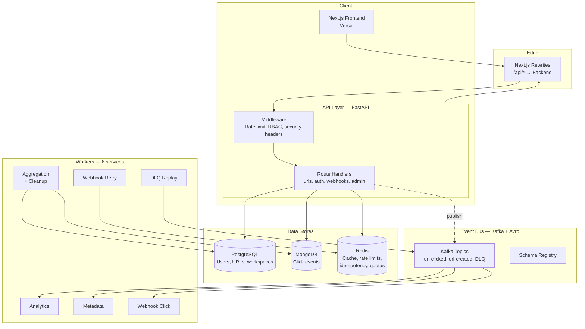
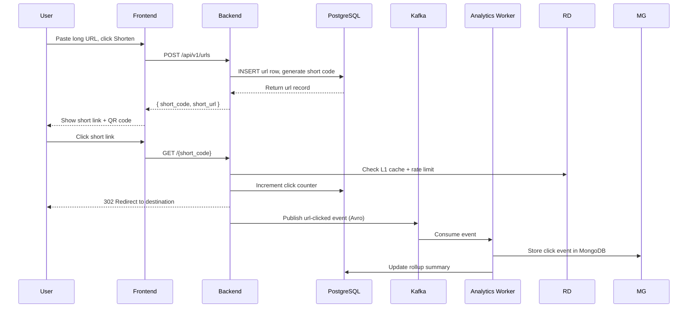

# LinkForge

Enterprise-grade URL shortening platform with multi-tenant workspaces, real-time click analytics, QR codes, signed webhooks, API keys, and an event-driven worker architecture.

## What It Does

LinkForge turns long URLs into short, shareable codes — and tracks every click. Teams organize links in workspaces, protect them with passwords or expiration dates, route iOS/Android traffic differently via A/B device targeting, and stream click events to their own webhooks.

```
┌─────────────────────────────────────────────────────────────┐
│                         LinkForge                            │
├─────────────────┬─────────────────┬─────────────────────────┤
│  Shorten & Share│   Analyze      │   Automate               │
│  • Custom codes │  • Live stats   │  • Webhooks              │
│  • QR codes     │  • Timeseries   │  • API keys              │
│  • Passwords    │  • UTM/referrer │  • Bulk CSV import       │
│  • Expiration   │  • Device stats │  • Workspaces            │
└─────────────────┴─────────────────┴─────────────────────────┘
```

## Architecture



## Data Flow



## Folder Structure

```
url-shortner/
├── README.md
├── backend/
│   ├── src/
│   │   ├── admin/          # Superadmin panel, audit logs
│   │   ├── analytics/      # Click rollups, timeseries
│   │   ├── identity/       # Auth, JWT, OAuth, sessions
│   │   ├── links/          # URL CRUD, redirect, QR, A/B
│   │   ├── shared/         # Config, security, middleware, events, workers
│   │   ├── webhooks/       # Subscriptions, delivery, DLQ
│   │   └── workspaces/     # Multi-tenant isolation, invites
│   ├── alembic/            # DB migrations
│   ├── scripts/            # Maintenance (e2e_server, purge_users)
│   ├── tests/              # Unit, route, core, event tests
│   ├── render.yaml         # Render blueprint
│   └── pyproject.toml      # Python deps (uv)
├── frontend/
│   ├── src/
│   │   ├── app/            # Next.js App Router pages
│   │   ├── components/     # UI + layout
│   │   ├── lib/            # API client, schemas, utils
│   │   ├── hooks/          # React Query, custom hooks
│   │   ├── queries/        # TanStack Query keys
│   │   └── store/          # Client state
│   ├── test/               # Vitest + MSW
│   ├── e2e/                # Playwright
│   ├── next.config.ts      # Rewrites to backend
│   └── package.json
├── docker/
│   └── docker-compose.yml  # Local Postgres, Mongo, Redis, Kafka
├── docs/                   # Runbooks, SLO, alerting
├── load-tests/             # Locust
└── .github/workflows/      # CI/CD (lint, test, build, publish)
```

## Tech Stack

| Layer | Technology |
|---|---|
| Frontend | Next.js, React, TypeScript, Tailwind CSS, shadcn/ui |
| Backend | Python 3.13, FastAPI, SQLAlchemy 2, Alembic |
| Databases | PostgreSQL, MongoDB, Redis |
| Event Bus | Apache Kafka + Schema Registry (Avro) |
| Auth | JWT (access/refresh), OAuth 2.0 (Google, GitHub), Argon2 |
| Observability | OpenTelemetry → collector → metrics/traces/logs; `/metrics` |
| CI/CD | GitHub Actions, GHCR image publishing |
| Deployment | Render (backend), Vercel (frontend) |

## Features

### Core
- **URL Shortening** — Custom aliases, auto-generated short codes (Base62)
- **QR Codes** — Per-URL QR generation, bulk QR ZIP download
- **Password Protection** — Gate access with a password
- **One-Time URLs** — Self-destruct after first visit
- **A/B Testing** — Device-specific redirects (iOS / Android / default)
- **URL Expiration** — Auto-disable links at a set date/time
- **Bulk Operations** — CSV import, bulk update/disable/delete, CSV/JSON export

### Analytics
- Click count, unique visitors, device/browser/OS breakdown
- Geographic data (country, city), UTM campaign breakdown, referrer breakdown
- Daily timeseries (up to 90 days)
- Aggregated rollups updated every 60s by a dedicated worker

### Teams & Collaboration
- **Workspaces** — Multi-tenant isolation with CRUD
- **Roles** — Admin / Editor / Viewer with RBAC enforcement
- **Invites** — Email-based workspace invitations
- **Folders & Tags** — Organize URLs within workspaces

### Developer Tools
- **API Keys** — Create, revoke, rotate with per-key quota tracking (Redis daily limits)
- **Webhooks** — Subscribe to `url.clicked` events with HMAC-SHA256 signed delivery
- **Webhook Receiver** — Ingest webhooks from external services, view event history

### Admin
- Superadmin panel — List users/workspaces/URLs, toggle superadmin, platform-wide stats
- **Audit Logs** — Track all mutations by workspace, resource, or actor

### Security
- Argon2 password hashing
- JWT access + refresh token pair with Redis blacklisting
- Rate limiting — Token bucket (IP-level + user-level)
- RBAC middleware — Write-permission enforcement
- SSRF-safe outbound fetches (pinned public IP, no private/loopback/metadata IPs)

## API Overview

All routes live under `/api/v1/` — the only exception is the redirect at `GET /{short_code}`.

| Resource | Key Endpoints |
|---|---|
| **Auth** | `POST /auth/register`, `POST /auth/login`, `POST /auth/refresh`, `GET /auth/me`, `POST /auth/oauth/{provider}` |
| **URLs** | `GET/POST /urls`, `GET/PUT/DELETE /urls/{id}`, `GET /urls/{id}/qr` |
| **Analytics** | `GET /analytics/{short_code}/summary`, `/timeseries`, `/devices`, `/utm`, `/referrers` |
| **Workspaces** | `GET/POST /workspaces`, `POST /workspaces/{id}/invites`, `GET /workspaces/{id}/members` |
| **Webhooks** | `POST/GET /webhooks/workspace/{ws_id}`, `POST /webhook-receiver` |
| **API Keys** | `POST/GET /api-keys`, `DELETE /api-keys/{id}`, `POST /api-keys/{id}/rotate` |
| **Bulk** | `POST /urls/bulk/create`, `GET /urls/bulk/export`, `GET /urls/bulk/qr` |
| **Admin** | `POST /admin/seed` (bootstrap-token gated), `GET /admin/users`, `GET /admin/stats`, `PATCH /admin/users/{id}/toggle-superadmin` |

Redirect: `GET /{short_code}` — 302 redirect with password protection, A/B testing, and device-specific URLs.

Health: `GET /health` returns `{"status": "healthy", "database": true, "redis": true, "kafka": true}`.

## Local Development

### Prerequisites
- Python 3.13+, Node.js 22+, [uv](https://docs.astral.sh/uv/), Docker (for data stores / testcontainers)

### 1. Start data stores
```bash
docker compose -f docker/docker-compose.yml up -d postgres mongodb redis
```
Docker is only used for local development — production runs on Render/Vercel without it. For the full local event pipeline, also bring up `kafka` and `schema-registry` from the same file.

### 2. Backend
```bash
cd backend
uv venv
uv sync
cp .env.example .env        # configure credentials
uv run alembic upgrade head
uv run uvicorn src.main:app --host 127.0.0.1 --port 8000
```

Run the backend standalone (without embedded workers):
```bash
set STANDALONE_WORKERS=1
uv run uvicorn src.main:app --host 127.0.0.1 --port 8000
```

### 3. Frontend
```bash
cd frontend
npm ci
npm run dev                 # http://localhost:3000
```
The frontend proxies `/api/*` and `/{short_code}` to the backend via Next.js rewrites.

### 4. Workers (one terminal each)
```bash
cd backend
uv run python run_worker_analytics.py
uv run python run_worker_metadata.py
uv run python run_worker_webhook_click.py
uv run python run_worker_webhook_retry.py
uv run python run_worker_dlq_replay.py
uv run python run_worker_aggregation.py
```

### 5. Enable the admin panel
Set `ADMIN_BOOTSTRAP_TOKEN` in `backend/.env` first (any random 32+ char string:
`openssl rand -hex 32`). The endpoint is disabled with a 404 while empty, so a
fresh database can't be claimed by the first account to register.
```bash
curl -X POST http://localhost:8000/api/v1/admin/seed \
  -H "Authorization: Bearer <your-access-token>" \
  -H "X-Admin-Bootstrap-Token: <ADMIN_BOOTSTRAP_TOKEN>"
```
The first superadmin can then access the Admin section in the sidebar. Once bootstrapped, a superadmin can promote others from the panel — the endpoint refuses to run a second time.

Note: an admin cannot demote or deactivate themselves, and cannot remove the last remaining superadmin. Both would lock the platform out permanently.

## Environment Variables

Copy `backend/.env.example` to `backend/.env` and fill in your values.

| Variable | Purpose |
|---|---|
| `DATABASE_URL` | PostgreSQL connection string |
| `MONGODB_URI` / `MONGODB_DB` | MongoDB for click analytics |
| `REDIS_URL` | Redis connection string (Upstash or plain) |
| `KAFKA_BOOTSTRAP_SERVERS` | Kafka host:port |
| `KAFKA_SASL_USERNAME` / `KAFKA_SASL_PASSWORD` | Kafka SASL credentials |
| `KAFKA_SSL_CA_PATH` | Path to `ca.pem` (local); on Render use `KAFKA_SSL_CA` with cert contents |
| `SCHEMA_REGISTRY_URL` | Schema registry URL |
| `SECRET_KEY` | JWT signing key (`openssl rand -hex 32`) |
| `GOOGLE_OAUTH_CLIENT_ID` / `GOOGLE_OAUTH_CLIENT_SECRET` | Google OAuth |
| `GITHUB_OAUTH_CLIENT_ID` / `GITHUB_OAUTH_CLIENT_SECRET` | GitHub OAuth |
| `OTEL_EXPORTER_OTLP_ENDPOINT` / `OTEL_EXPORTER_OTLP_HEADERS` | OTLP collector endpoint (`http://localhost:4318` locally) |
| `FRONTEND_URL` / `BACKEND_URL` | Public URLs for redirects / CORS |
| `ADMIN_BOOTSTRAP_TOKEN` | Admin panel bootstrap token |

## Testing

> Warning: Never run the full pytest suite against the production database. DB-backed tests truncate tables and require Docker testcontainers.

```bash
# Backend — safe without Docker (unit tests only)
cd backend && uv run pytest tests/test_core tests/test_events -q -o addopts=''

# Backend — full suite with Docker testcontainers (Postgres/Mongo/Redis)
cd backend && uv run pytest tests/ --use-testcontainers

# Frontend
cd frontend && npm run lint
cd frontend && npm run test          # Vitest unit tests
cd frontend && npm run test:e2e      # Playwright e2e tests
cd frontend && npm run test:coverage # with coverage report
```

CI runs on every push to `main` (GitHub Actions): lint, tests, build, and Docker images published to GHCR.

## Deployment

### Backend — Render
Deploys from the `backend/render.yaml` blueprint. Build: `pip install uv && uv sync --no-dev`. Start: migrations then `uv run uvicorn src.main:app --host 0.0.0.0 --port $PORT`. Workers run embedded in the web service.

### Frontend — Vercel
Auto-deploys from `main`. Server-side rewrites proxy `/r/:code` and `/api/v1/*` to the Render backend via `BACKEND_URL`.

## License

MIT
